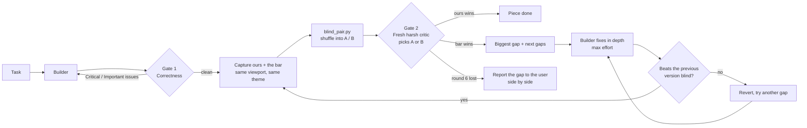

<div align="center">

# Gauntlet Loop MAX

**Make your agent's work pass two gates: it has to work, and it has to beat a real reference in a blind test.**

A Claude Code skill · Correctness gate + blind taste gate · Up to 6 max-effort rounds

[](LICENSE)


</div>

---

## The problem

AI agents grade their own homework. Ask one to "make it look like Stripe" and it will tell you it
does. Hand it a severity review and it will fix every bug, then ship something that functions but
doesn't feel right.

The [gauntlet loop](https://github.com/robonuggets/gauntlet-loop) solved half of this. It fixes a
real reference as the bar, has a harsh critic compare against it blind, and loops until the work
wins. Gauntlet Loop MAX adds the half it was missing: a strict **correctness gate** first, then a
**taste gate** that runs at maximum effort, can't regress, and knows when to stop.

## How it works



### Gate 1: Correctness, which proves it works

- An independent reviewer checks the work against the spec and the plan.
- Findings are ranked Critical, Important or Minor.
- Fix rounds run until no Critical or Important issue is left, with tests green.

### Gate 2: Taste, which proves it's good

- **The bar:** a real reference that is named, fetchable and comparable. It can be the mockup you
  sent, the best in class captured at the same viewport, or at minimum the previous version.
- **Small pieces:** the work is split into pieces small enough to judge on their own, such as a
  header, a chart, a card, an opening paragraph.
- **The critic:** each round brings a **new critic** with fresh context. It gets two unlabelled
  files and answers in a fixed format:

  ```
  WINNER: A | B
  BIGGEST_GAP: the single biggest reason the loser loses
  NEXT_GAPS: one or two more, or "none"
  ```

  It gives no score and calls no tie. Scores drift up every round; a choice doesn't.
- **The loop:** it runs until ours wins, for **at most 6 rounds per piece**.

## What MAX adds to the original gauntlet loop

| | gauntlet-loop | **Gauntlet Loop MAX** |
|---|---|---|
| What it produces | A paste-ready prompt for a fresh session | Runs the loop inside your build process |
| Correctness | Not covered | Spec + quality review, severity-ranked, fix rounds |
| Blind A/B | Asked for in the prompt | Enforced by `blind_pair.py`; the critic never sees the key |
| Feedback per round | Single biggest gap | Biggest gap **plus** 1–2 next gaps, so each round fixes more |
| Regressions | Not checked | Each new version must also beat the previous one blind, or it's reverted |
| Effort | Not specified | Most capable model, maximum reasoning, builder measures the bar first; fresh builder from round 4 |
| Exit | Win, or you stop it | Win, or **6 rounds**; a loss is reported with both captures, never as a match |
| Memory | Conversation only | Progress ledger: the bar, each round, every decision, so it survives context resets |

## Quick start

**1. Install**

```bash
git clone https://github.com/daanv310/gauntlet-loop-MAX.git
mkdir -p ~/.claude/skills
cp -r gauntlet-loop-MAX/.claude/skills/gauntlet-loop-max ~/.claude/skills/
```

Want it in one project only? Copy the folder into that project's `.claude/skills/` instead.

**2. Use it**

Just ask, and attach the reference:

> Gauntlet this dashboard against the mockup I attached.

> Build the pricing page and loop until it beats Stripe's pricing page at 1440 px.

> Rewrite this landing copy. The bar is Linear's homepage hero.

It also triggers by itself when subagents build visual or written work, or when you hand over an
image or link to replicate.

**Requirements**

- Claude Code with subagents.
- A way to capture the work: a browser or Playwright for UI, plain files for text.
- Python 3 for `blind_pair.py`, which uses only the standard library.

## Choosing a good bar

| Goal | A bar that works |
|---|---|
| Website, app, UI | A specific best-in-class page, screenshotted at the same viewport and theme |
| Your own design | The mockup or screenshot you were given; approved improvements count as part of the bar |
| Writing | A specific published piece of the same length and format |
| Visual, motion | Footage or frames from a named product, captured at the same size |
| Docs, decks | A real artifact from a team known for it |

A vague bar ("modern dashboards") lets the critic approve everything, and it's the most common way
a gauntlet fails. Whenever there's a number to watch (load time, contrast ratio, word count), state
it next to the reference.

## What's inside

```
.claude/skills/gauntlet-loop-max/
├── SKILL.md              # the full process, prompts and rules
└── scripts/
    └── blind_pair.py     # shuffles ours/bar into A/B, prints the key only to the lead agent
```

## FAQ

**Why cap at 6 rounds if the original says never cap?**
Every round costs usage and budget, and an endless loop can stall everything else you're running.
MAX spends maximum effort on each round so it usually wins well before the cap, and when it
doesn't, you get the exact remaining gap instead of a silent "looks good".

**Why not just score the result from 1 to 10?**
Scores creep up each round even when nothing improved. "Which of these two is better?" doesn't
creep.

**Does it work for backend code?**
There the test suite is the bar, so only the correctness gate applies. The taste gate is for work a
person looks at or reads.

## Credits

- **The gauntlet loop technique** is by Matt Shumer, from his Claude of Duty project.
- **The original skill**, [robonuggets/gauntlet-loop](https://github.com/robonuggets/gauntlet-loop),
  is by Jay E at RoboNuggets and licensed CC BY 4.0. Gauntlet Loop MAX is a derivative work: it
  keeps that skill's bar rules, blind critic and win-to-exit loop, and builds on them.
- Anthropic's [Building effective agents](https://www.anthropic.com/engineering/building-effective-agents)
  describes the evaluator-optimizer pattern behind both.

## License

[CC BY 4.0](LICENSE). Share and adapt it freely, commercially too, as long as you credit this
repository and the original works above.
